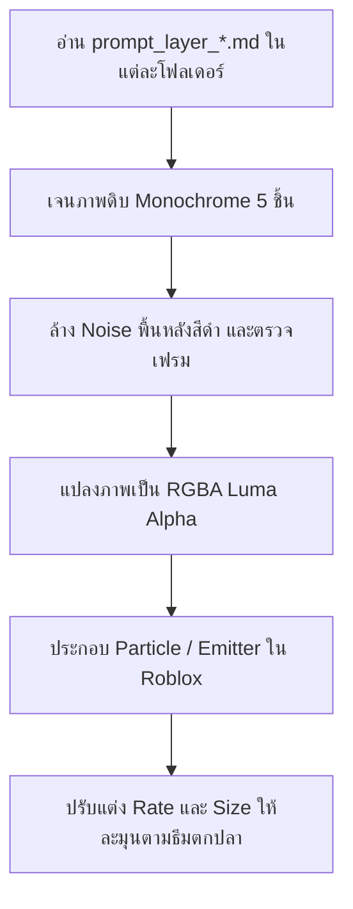

# Aura Fishing - AI Agent VFX Production Guide

คู่มือฉบับนี้จัดทำขึ้นสำหรับ **AI Agent** ที่รับหน้าที่สร้างภาพ Texture / Flipbook Grids ด้วย AI (เช่น Midjourney, Stable Diffusion, ComfyUI, DALL-E) และนำภาพเข้าสู่เอนจิน Roblox Studio หรือ Universal Shader

---

## 1. ข้อกำหนดทางเทคนิคของภาพดิบ (Image Generation Standards)

เพื่อให้การประมวลผล Texture ไปใช้ใน Roblox หรือ Shader มีประสิทธิภาพสูงสุด:

### 1.1 ใช้ระบบ Monochrome (Pure White on Black `#000000`)
- ภาพต้นฉบับทั้งหมดต้องถูกสร้างเป็น **สีขาวบริสุทธิ์บนพื้นหลังสีดำสนิท** (Luma Matte)
- **เหตุผล:** ในเอนจินเกม การย้อมสีด้วย `ColorSequence` หรือ Shader จะทำจากค่าความสว่าง (Luminance) หากมีสีปนมาในภาพดิบ จะทำให้การเกลี่ยสีในเกมเพี้ยน และเปลืองหน่วยความจำ VRAM โดยไม่จำเป็น
- สีจริงของออร่าในเกมจะถูกควบคุมผ่านตาราง Config ใน `src/shared/Config/Auras.luau`

### 1.2 ขนาดภาพและสัดส่วน Grid
- **4x4 Flipbook Grids:** ความละเอียดแนะนำ `1024x1024` หรือ `2048x2048` พิกเซล (16 เฟรม เรียงซ้ายไปขวา บนลงล่าง)
- **2x2 Static Atlases:** ความละเอียดแนะนำ `512x512` หรือ `1024x1024` พิกเซล (4 รูปทรงแยกอิสระ พร้อมขอบปลอดภัยรอบรูปทรง)
- **1x1 Seamless Strips:** ความละเอียดแนะนำ `1024x256` หรือ `2048x512` พิกเซล (ไร้รอยต่อแนวนอน Horizontal Tileable)

### 1.3 ข้อห้ามเด็ดขาด (Crucial Negative Prompts)
เมื่อส่งคำสั่งให้ AI วาดภาพ ให้แนบ Negative Prompts เหล่านี้เสมอ:
```text
no violent explosions, no fiery blast waves, no jagged attack spikes, no dark battle aura, no anime combat vfx, no smoke grenades, no solid border lines, no frame grid lines, no text, no watermark, no compression artifacts, no gray background noise
```

---

## 2. ขั้นตอนการทำงานของ AI Agent (Workflow Steps)



### ขั้นที่ 1: ตรวจสอบรายการไฟล์เป้าหมาย
ในแต่ละโฟลเดอร์ออร่า มีไฟล์ภาพที่ต้องสร้าง 5 ประเภท:
1. `01_core_*_4x4.png` (Core Upward Plumes / Motes)
2. `02_ground_*_4x4.png` (Ground Ripple / Caustic Disk)
3. `03_orbital_*` (Orbital Water Stream หรือ Spirit Silhouette)
4. `04_star_flares_*_4x4.png` (Star Glints / Specular Sparkles)
5. `05_sparks_atlas_*_2x2.png` (Droplets, Spores, Bubbles, Petals)

### ขั้นที่ 2: Image Processing (Luma to Alpha)
เมื่อได้ไฟล์ภาพมาแล้ว นำเข้าสคริปต์ประมวลผล:
- กรองพิกเซลความสว่างต่ำ $L \le 0.05$ ให้เป็นสีดำสนิท $0.0$ เพื่อตัดกรอบสี่เหลี่ยม
- คัดลอกค่าความสว่าง $L$ ไปไว้ในช่อง Alpha Channel ($A = L$)
- บันทึกเป็นไฟล์ PNG RGBA สำหรับนำเข้า Roblox Asset Manager

### ขั้นที่ 3: ตั้งค่าใน Roblox Studio
อ้างอิงค่าพารามิเตอร์จากไฟล์ `pipeline_spec_<aura_id>_vfx.md` ของแต่ละออร่า:
- สร้าง `Attachment` ภายใต้ `HumanoidRootPart` ของตัวละคร
- ติดตั้ง `ParticleEmitter` แยกตาม Layer
- กำหนด `ColorSequence` ตามรหัสสี RGB ที่ระบุไว้ใน `pipeline_spec`
- กำหนด `TransparencySequence` เพื่อให้หัว-ท้ายของอนุภาคค่อยๆ ปรากฏและเลือนหายอย่างนุ่มนวล

## 3. ชุดภาพต้นทาง 2026-11-23

ใช้ ImageGen แบบ 1 คำสั่งต่อ 1 ชีต ไล่ตามออร่า Tidal Bloom, Moonlit Ripple และ Nebula Koi ครบออร่าละ 5 ชีต รวม 15 ชีต มีการเจนแผ่นรวมเพื่อทดลองอีก 1 ครั้งก่อนเริ่มชุดแยก

| ชีต | ขนาด PNG | การจัดภาพ |
| --- | --- | --- |
| Core, Ground, Flares | 1024x1024 | Flipbook 4x4 ช่องละ 256x256 เรียงจากซ้ายไปขวาและบนลงล่าง |
| Orbital | 1024x256 | แถบแนวนอน เกลี่ยภาพซ้อนช่วงปลาย 8% เพื่อให้ขอบซ้ายและขวาตรงกัน |
| Sparks | 512x512 | Atlas 2x2 ช่องละ 256x256 ตามลำดับในพรอมป์ |

ไฟล์เป็นภาพขาวบนดำสำหรับขั้น Luma to Alpha ปรับขนาดและเก็บขอบดำของแต่ละช่องไว้ เลเยอร์ทั้ง 5 อยู่ครบใน [Tidal Bloom](TidalBloom/README.md), [Moonlit Ripple](MoonlitRipple/README.md) และ [Nebula Koi](NebulaKoi/README.md)

<details>
<summary>ชุดพรอมป์ที่ส่งให้ ImageGen</summary>

เริ่มด้วยข้อความร่วม แทน `<AURA>` ด้วยชื่อออร่าและ `<IDENTITY>` ด้วยบรรทัดสไตล์ จากนั้นต่อด้วยโครงสร้างชีตและข้อความ `Production brief:` ตามด้วยพรอมป์ของเลเยอร์ในโฟลเดอร์ออร่า เติมบรรทัดเฉพาะเลเยอร์ท้ายพรอมป์ตามรายการด้านล่าง

```text
Create exactly ONE high-quality 2D VFX texture sheet for the original cozy fishing game Aura Fishing, for the <AURA> effect. Shader tint mask on a perfectly solid true black #000000 background. Luminous white through grayscale only. A clean bright core with soft feathered edges and wide black padding. Visual identity is <IDENTITY>. No labels, text, numerals, grid lines, borders, characters, landscape scene, violent explosion, colored pixels, watermarks, or background texture. Render the flat sprite texture itself filling the canvas.
```

- Tidal Bloom — `shallow spring lake, wispy water vapor, delicate blossom petals and seafoam`
- Moonlit Ripple — `very clean calm-lake highlights with a soft silvery sheen`
- Nebula Koi — `an airy, luminous star pond with a refined soft starlight sheen`

โครงสร้างชีต

**Flipbook 4x4**

```text
Square 1:1 image. Exactly sixteen frames laid on a strict 4-column by 4-row grid with equal square cells. Frame centers follow 12.5%, 37.5%, 62.5%, 87.5% of the canvas on both axes. Read frames row-major left to right, top to bottom. Depict one coherent progression of the same motif with smoothly changing scale, shape, and glow across all 16 frames. First and last frames still clearly visible but small/dim. Use a single fixed pivot for every frame; apply motion internally. All frames lie wholly within their own cells, at least 12% edge padding, including the last frame. Leave cell boundaries invisible on pure continuous black canvas.
```

**Strip**

```text
One wide horizontal ribbon strip, ideally 4:1, under 35% of the canvas height centered left-to-right vertically with black above and below. The main ribbon passes continuously across the left and right edges and its edge heights and values align for horizontal wrap. Depict one narrow water band with a calm slight wave, no large empty gaps. Include only the strip. Any details should be contained horizontally so the only features at the left and right edges are the faint ends of the water ribbon.
```

**Atlas 2x2**

```text
Square 1:1 image. Exactly four separate motifs in a strict 2-by-2 grid. Use the motif order in the production brief. Center each at 25% or 75% canvas coordinates, isolated, maximum 72% of each cell width and height. Keep every cell edge black. Preserve the distinct silhouette of each particle.
```

บรรทัดเฉพาะเลเยอร์

- `TidalBloom/02_ground_blossom_ripple_4x4.png` — Top-down camera pointing straight down. Keep each ring and its scattered petals contained within the cell. The side-facing surface, horizon and vapor plumes are absent.
- `TidalBloom/03_orbital_petal_drift_strip.png` — Wide composition. Aim for a ribbon thin enough to fit into a 4:1 crop cut through the middle of the rendered image. The petals are secondary to the narrow band.
- `MoonlitRipple/01_core_moonbeam_mist_4x4.png` — A narrow isolated rising plume with light stardust. Show only water vapor. Exclude a ground disk, ring, pedestal, moon symbol, splash crown and starburst. Align the bottom of the plume across each tile.
- `MoonlitRipple/02_ground_lunar_concentric_ripple_4x4.png` — An overhead concentric lake ripple with a completely open dark central area. Keep the band thin and delicate. Keep vapor, moon symbols and flares out of this layer.
- `MoonlitRipple/03_orbital_silver_halo_strip.png` — One slender horizontal flowing silver ribbon, a few tiny flashes contained along it. Use an extremely wide canvas. No moon or clouds, no repeated vertical rows.
- `MoonlitRipple/04_moonlit_diamond_glints_4x4.png` — Only a single slender four-point diamond glint and soft circular glow per frame. Exclude water rings, water ribbons, vapor, crescent or separate particles. A small, clean centered star twinkle.
- `MoonlitRipple/05_silver_droplets_atlas_2x2.png` — The round droplet, crescent, diffuse orb and tiny diamond are four separate particles in their specified row-major order. No extra orbital lines or decorative backgrounds.
- `NebulaKoi/01_core_nebula_mist_4x4.png` — One slim rising plume of astral mist in each cell, with small stardust points inside the flow. Reserve the fish for its own sheet. Exclude a ground disk, planets and water splash crown. Keep the bottom pivot fixed.
- `NebulaKoi/02_ground_starlight_pond_4x4.png` — One isolated shallow circular pond ripple per frame as seen vertically from above. Expanding arcs of delicate watery caustic lines with a few star points twinkling within the disk. Keep the center mostly dark and reserve koi for their own sheet.
- `NebulaKoi/03_orbital_koi_swim_strip.png` — A very wide single strip. Put two small distinct fully visible side-view ethereal koi along the central flowing water ribbon, both swimming in the same direction, with graceful forked fins and very subtle stardust. Leave plenty of water-only ribbon on each end and ensure the thin band meets the left and right edges at the same height.
- `NebulaKoi/04_cosmic_star_flares_4x4.png` — A single stellar four-point flare in each cell, tapering horizontally with a soft round glow and only a few very small stellar points close to center. Keep fish, water ripples and wisps out of this sheet.
- `NebulaKoi/05_stardust_scales_atlas_2x2.png` — Top-left one rounded fan-shaped fish scale with softly luminous fine nested curves. Top-right one fine four-point star mote. Bottom-left one curled lotus petal flake. Bottom-right one small round-to-tapered curved water droplet. Four separate centered motifs in precisely this order.

</details>

## 4. ทิศทางภาพก่อนเจนรอบถัดไป

พรีวิว Dark Arcane มีแกนไฮไลต์คมซ้อนกับแสงฟุ้ง ระลอกที่วิ่งจากศูนย์กลางออกไป และวงโคจรที่เอียงหลายมุม โครงจังหวะนี้นำมาใช้กับ Aura Fishing โดยให้แสงเคลื่อนเหมือนสายน้ำ หมอก กลีบดอก และการว่ายของวิญญาณสัตว์ สีและรูปทรงยึดโทน Cozy Lake ของแต่ละออร่า [พรีวิว Dark Arcane](sample/dark-arcane-preview.html) [พรีวิวทั้งชุด](preview.html)

| ชีต | หน้าที่ตอนประกอบ |
| --- | --- |
| `01 Core` | แกนเดียวกลางเท้า ขนาดและจุดยึดอยู่ที่เดิม เคลื่อนไหวภายในทรงหลักแล้วเฟดต้นและท้ายลูป |
| `02 Ground` | ดันระลอกและขอบแสงออกจากกลางเท้า เฟดระหว่างที่วงขยาย ใช้ระลอกรองตามหลังใน Tier 2–3 |
| `03 Orbital` | พัน Strip รอบเอวเป็นสายหลักและเพิ่มริ้วน้ำสั้นเอียงคนละมุมใน Tier 3 ให้หัวสัตว์อ่านชัด ส่วนปลายเป็นหางแสง |
| `04 Glints` | เติมประกายที่ขอบระลอกและปลายริ้วช่วงสั้น ๆ เน้นจังหวะที่สายน้ำรับแสง |
| `05 Particles` | ปล่อยอนุภาคจากโคนแกนให้กระจายต่ำออกข้างตามระลอก แล้วเฟด อีกส่วนลอยช้า ๆ ใกล้ตัว |

เพิ่มความเด่นตามความหายากด้วยระยะที่ระลอกแผ่ จำนวนละออง และระยะเวลาที่แสงค้าง Tier 3 ของ Common ถึง Rare ใช้ริ้วตาม 1 สาย ส่วน Epic ถึง Mythic ใช้ 2 สาย ความใสของแกนและช่องว่างกลางระลอกช่วยให้ยังเห็นตัวผู้เล่นและเบ็ด

ไฟล์ `preview.html` ในแต่ละออร่าเปิดมาที่ออร่านั้น ชุด Tidal Bloom, Moonlit Ripple และ Nebula Koi แสดงชีตของตัวเอง อีก 12 แบบใช้เท็กซ์เจอร์น้ำและอาร์ตที่มีในโปรเจกต์เพื่อดูระยะ สี และจังหวะ รูปทรงเฉพาะของแต่ละออร่าระบุในพรอมป์ 5 ใบของโฟลเดอร์นั้น

ตรวจ `01` ว่าโคนและขนาดนิ่งตลอดลูป ตรวจ `02` ว่าขอบระลอกเคลื่อนออกทางเดียว และตรวจ `03` ว่ารอยต่อซ้ายขวาเป็นช่วงน้ำต่อเนื่องที่ตัดไปใช้เป็นริ้วรองได้
